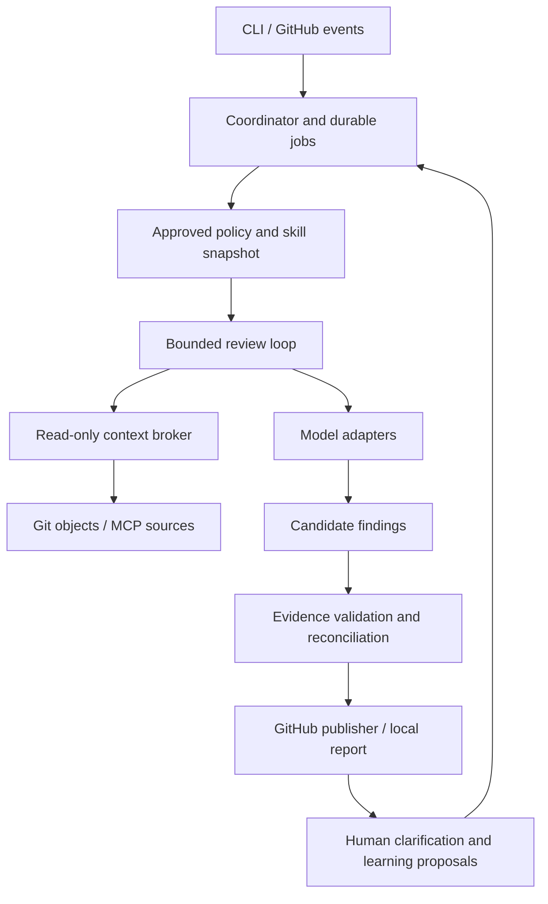

# rush — Technical Specification

Version 0.5 · 29 October 2026 · Meta-only hackathon scope

## 1. Purpose and scope

Build an open-source reviewer that identifies issues attributable to a code change, applies approved team standards, retrieves necessary ticket/wiki context through MCP, and explains findings that humans can question. Learning changes review behavior only after authorized approval.

This specification translates **rush — Minimal PRD**, `docs/product-requirements.md`, into a build plan. The source file’s SHA-256 is `c72c333d1d7934080a009fe76260b78baff0e841a1cc512696a1166d3e135fae`. The PRD and agreed conversation requirements are authoritative. Python and FastAPI are the selected language/framework; supporting libraries, limits, interfaces, dates, and acceptance targets below are proposed engineering decisions, not existing capabilities or measured results.

**Hackathon boundary:** one GitHub repository, one team, a small skill bundle, live ticket and guideline retrieval, a Meta-powered primary workflow, and configurable Meta models behind a replaceable provider interface. Use GitHub comments and a CLI as the interface. No custom dashboard is needed.

**Development agreement:** the companion `docs/development-guide.md` governs how this product is built. Its required layout, class-based services, provider interfaces, meaningful tests, and backend CI gates apply to all further implementation. These are engineering requirements for our own repository; they do not add coverage audits or dedicated security scanning to the reviewer’s product scope.

**Current project decisions:** the application and CLI are named `rush`; preserve
the TCR ticket IDs. Run and test through Docker Compose without a host venv.
Complete each ticket in its ticket-linked branch, open its PR, and wait for human
review and merging before starting another ticket. See `docs/setup-record.md`
for repository, license, ownership, and actual setup evidence.

**Excluded:** coverage assessment, general test audits, dedicated security scanning, automatic fixes or merges, code generation, engineering reporting, post-merge workflows, a skill marketplace, whole-repository indexing, and automatic exploration of other repositories. Apparent security issues may still be findings when supported by the diff.

## 2. Proposed architecture and stack

Use a single Python package with shared core modules, a CLI entry point, and a FastAPI GitHub webhook service. Start with one ASGI server process, one supervised review-consumer task, and SQLite on a persistent volume. This deliberately avoids a distributed queue and separate frontend during the hackathon.

| Concern | Proposed choice | Boundary |
|---|---|---|
| Language/runtime | Python; pin a supported release compatible with the selected dependencies | Python is selected; freeze exact versions in Stage 0. |
| Web service | FastAPI with Uvicorn | Keep HTTP handlers thin; core review logic is shared with the CLI. |
| Validation | Pydantic models and generated JSON Schema | Validate config, tool arguments, model responses, and persisted records. |
| Outbound HTTP | HTTPX asynchronous clients | Shared clients, explicit timeouts, bounded retries, cancellation propagation. |
| CLI | Python console entry point using argparse | Call the same core through an async entry point; no running web server required. |
| GitHub integration | GitHub App; webhook receiver and API publisher | No repository content writes or merge permission. |
| MCP | Official Python SDK; remote HTTP connections initially | Operator-authorized endpoints and tools only. Local stdio transport can follow. |
| Models | Meta adapter behind a provider-neutral interface; explicit model choice per task | Other providers are deferred by the owner; multiple Meta models do not prove cross-provider compatibility. |
| Persistence | SQLite through aiosqlite, versioned SQL migrations, JSON payload columns, transactional job/outbox tables | Single service instance; serialize transaction ownership; no shared network-mounted database or multi-node deployment. |
| Rules/skills | Reviewed files plus approved, immutable state snapshots | Load from trusted policy revision, never from the PR head. |
| Deployment | Container with mounted state and injected secrets | Reviewed source is data, never a startup or installation script. |
| Verification | pytest, async integration tests, skill fixtures, end-to-end demo; Ruff and a Python type checker | These test the reviewer, not the submitted application’s coverage. |

FastAPI owns webhook and connector OAuth callback endpoints. Verify webhook signatures against the raw request bytes before parsing the event. Use its lifespan boundary to open shared HTTP/MCP/database resources and supervise the consumer, with explicit shutdown and cancellation handling [S10–S12]. Persist each job before returning an acknowledgement; the database is the queue of record, not an in-memory task or request-scoped background callback. Restart recovery uses the existing job leases and outbox. Offload blocking Git subprocess/file operations from the event loop, and do not hold a database transaction across model or network calls.

Required package layout: `app/main.py`, `app/dependencies.py`, `app/routers/`, `app/internal/`, `app/core/`, `app/models/`, `app/schemas/`, `app/services/`, `app/db/` with `app/db/migrations/`, and top-level `tests/`. Add `app/cli.py`, `skills/`, `scripts/`, and `docs/`. Keep the public CLI name `rush`. Define the installable package and CLI entry point in `pyproject.toml`; pin dependencies in a lock file. Run one Uvicorn worker for this combined service/consumer design; a separate worker deployment is a later change.

Business workflows belong in focused service classes. Define provider/repository interfaces in `app/services/ports.py`; place external implementations in `app/internal/adapters/` and database repositories in `app/db/repositories/`. Supply dependencies through constructors and wire them in `app/dependencies.py`. Routers and the CLI handle input/output and delegate; they do not contain review rules or query the database. `app/models/` holds business concepts; `app/schemas/` holds Pydantic data formats. The development guide defines allowed imports and their automated enforcement. Small pure helpers and route handlers need not be forced into artificial classes.

### Initial development setup — required

- Use the playbook’s applicable conventions, security, Python style, behavior-testing, Twelve-Factor, and version-control practices as adapted in the development guide. Preserve ticket IDs and review evidence; use short-lived branches into `main` for the MVP.
- Most tests exercise service/business behavior, including failure cases and regressions. Use temporary real SQLite for database/migration tests and substitutes for external services in ordinary CI. Do not test framework internals or add empty tests merely to raise coverage.
- Add a backend-only GitHub Actions workflow with formatting/lint, types, architecture, complexity/duplication, tests/coverage, dependency/secret/security checks, and migration/package checks. Set `backend-required` as a protected-branch requirement and prove failing or unexpectedly skipped prerequisite jobs cannot allow merging. Writing the workflow alone is not completion.
- Initial project defaults: 80% combined statement/branch coverage across application code with branch measurement enabled; 90% coverage of changed executable lines. These are configurable safeguards, not a quality score. Changes to thresholds/exclusions need explicit review, and critical behaviors require tests regardless of percentages.
- The required PR checks run without real provider credentials. Live model/MCP evaluation is separate, uses approved demo data and trusted code, and remains part of MVP acceptance.
- Keep secrets out of Git, fixtures, and logs; use environment-based deployment settings, locked dependencies, explicit migration commands, startup/shutdown handling, and durable state. Exposed credentials must be revoked/rotated rather than relying on a history rewrite.
- Implement and verify TCR-001A–001E before accepting feature work. CI enforcement is planned here, not already installed. See the development guide for job details, current sources, and the record of accessible/inaccessible playbook links.



The coordinator owns permissions, budgets, state transitions, and publication. A model can request context or propose findings; it cannot execute arbitrary tools, approve rules, or publish directly. Modules share a process in the prototype, but credentials stay in adapter/publisher closures rather than model inputs.

Repository content is read through Git objects or a read-only snapshot. Disable hooks, submodule execution, repository-supplied filters, and dependency installation. Validate paths and revisions and pass subprocess arguments without shell interpolation. Reviewing a contribution must never execute its code with service credentials.

## 3. Review lifecycle

1. **Accept:** validate webhook signature and event type, deduplicate delivery, authorize manual commands, and create a durable job before acknowledging the request. Use GitHub’s documented signature verification scheme [S1].
2. **Check eligibility:** target branch, draft state, labels, configured paths, pause state, and installation/repository allowlist. Exclusions produce an explicit skipped reason.
3. **Freeze inputs:** capture target/base SHA, merge-base SHA, head SHA, policy SHA, memory revision, skill digests, model configuration, and referenced source snapshots. References changing mid-run do not change this snapshot.
4. **Build scope:** compute the full PR diff from merge-base to head, or the incremental scope described below. Parse paths, additions/deletions, old/new line coordinates, renames, and hunk identifiers.
5. **Load context:** retrieve explicit ticket links and approved guideline sources. Load only the rule scopes relevant to changed paths. Missing required context creates a limitation, not an invented requirement.
6. **Run skills:** select applicable skills deterministically from path/service/file-type selectors. Process them sequentially initially; share retrieved context through the broker.
7. **Investigate:** allow a bounded question → requested read → evidence → answer loop. The host validates every request before executing it.
8. **Assess candidates:** validate schemas, locations, citations, applicable rules, exceptions, and connection to the diff; use a separate critique pass for semantic support and counterexamples.
9. **Reconcile and publish:** recheck the current PR head, update existing findings/summary, and record a check result. A stale run must not overwrite the current review.

States: `queued → preparing → reviewing → validating → publishing → completed`. Terminal alternatives: `partial`, `failed`, `superseded`, `cancelled`, `skipped`. Persist each transition and reason. Resume interrupted jobs from a safe checkpoint; never assume an interrupted publication failed to reach GitHub.

**Complete** means configured review work finished within the declared scope. It never means the change has been proven correct or secure.

### Full and incremental review

- First review and explicit `full`: inspect the complete PR diff.
- Subsequent push: compare the last completed reviewed head with the new head; review newly changed hunks, affected previous findings, and directly affected recorded dependencies. Keep the current full PR diff as the attribution boundary.
- Store reviewed hunk/content hashes and dependency edges. Reuse results only when their code, policy, skill, model configuration, and required external-context hashes remain unchanged.
- Force-push without a usable ancestry relationship, changed merge-base, changed policy/memory/model/skill inputs, changed required external context, or incomplete prior run forces a full review.
- Unchanged unresolved findings persist. A finding is resolved only after rechecking its relevant code; absence from a model response is not evidence of resolution. Unchecked findings become `needs_recheck`.
- Serialize jobs per PR and supersede older queued heads. If head changes during publication, stop remaining writes and mark any already-published output with its reviewed SHA as outdated.

## 4. Bounded investigation

Every additional code read must carry `question`, `origin_hunk_id`, `relationship`, `target`, and `expected_evidence`. Allowed relationships: direct caller/callee, import/dependency, shared interface/schema, explicit configuration reference, and a test specifically exercising the changed behavior.

The broker checks that the stated edge exists in already available code or an explicitly scoped symbol search. A guessed relationship is insufficient. Limit retrieval to snippets; further snippets consume budget. Stop when the question is answered. A reviewer saying “this file might be useful” is not enough.

**Proposed starting limits, configurable by the operator:**

| Budget | Initial limit | Exhaustion behavior |
|---|---:|---|
| Changed files / changed lines | 20 / 500 | Return partial with excluded scope; never silently truncate. |
| Additional code files / snippet reads | 8 / 16 | Record the unresolved question. |
| Relationship depth from a changed hunk | 2 edges | Ask for a human-authorized broader rerun if essential. |
| MCP calls / scoped searches | 6 / 1 | Record inaccessible/unretrieved context. |
| Model calls, including repairs and critique | 12 per review | Stop with partial results. |
| Total supplied source text | 128 KiB before prompt overhead | Select smaller relevant excerpts or return partial. |
| Review wall time | 180 seconds | Stop new work; finalize partial evidence. |

These are tuning defaults, not a performance promise. Adapter-specific context/token limits also apply; byte limits do not replace token limits. Reserve room for output. Count retries against the same budgets.

Cross-service findings require a documented chain from the diff to an accessible contract or directly connected implementation. Do not crawl another repository in v0.1. If proving the issue requires unavailable service code, keep it as an unresolved question in the summary rather than an asserted defect.

**Application tests:** no coverage tool, test-quality skill, or repository test execution by default. Reading a test requires a diff-specific question or an explicit approved team rule. v0.1 does not execute application tests; if execution is required to verify an issue, say `not executed` and report the verification gap. Do not claim a reproduction without execution evidence. Skill-evaluation tests remain mandatory and separate.

## 5. MCP context and source trust

### Initial integration

Propose **ClickUp tickets + Notion guidelines**. ClickUp’s documented MCP tools include task and document retrieval [S6–S7]; Notion documents a custom-client OAuth/PKCE and token-refresh flow [S8]. Prove authentication and exact tool schemas in Stage 0. The PRD also permits ClickUp for both tickets and guidelines; use that route if it materially simplifies the live demo. Jira remains an adapter target, not a required third integration.

The context broker exposes product-level operations such as `ticket.read(reference)` and `guideline.read(source_id)`. Provider mappings translate them into discovered MCP tool names and argument schemas; do not hard-code invented vendor tool names in skills.

### Retrieval policy

- Ticket links must come from the PR description or an explicit authorized command. Fetch only allowlisted workspace/project resources.
- Guideline locations come from approved configuration. An arbitrary ticket link cannot make a page enforceable policy.
- If a link is ambiguous, perform one narrow search in the configured project/space. Accept a match only with a unique identifier or clear source relationship; otherwise request clarification.
- Read linked content directly; never rely on a search snippet as the full ticket or guideline.
- Store source ID, canonical URL, connector/workspace identity, source version if exposed, retrieval timestamp, content hash, and the minimal passages used.
- Treat retrieval time as a timestamp, not as a provider revision. Record `version: null` when unavailable.
- Missing ticket, denied access, rate limit, truncated content, changed guideline, and conflicting sources produce distinct limitations.

### Approved guideline snapshots

Maintain an approved registry entry containing source ID, approved content hash, approved excerpt/rule definitions, scope, approver, approval time, and optional expiry. At run start, fetch the live page through MCP and compare the approved portions against the snapshot.

If content changed, preserve the prior approved version and propose an update. Do not silently enforce the new text. An unexpired approved snapshot may still be used if the team explicitly permits cached policy; disclose that choice. If current policy is required or no valid snapshot exists, mark affected checks incomplete.

### Authorization and data handling

The operator authorizes each connector once through its supported flow. Store refresh credentials in a protected secret store, handle refresh atomically, and stop with `reauthorization_required` when refresh fails. Never prompt for login inside an unattended review.

Only allowlisted read tools and resource IDs are available. Tool names or `readOnlyHint` annotations alone do not establish trust [S4]. Reject mutation tools, arbitrary URLs, redirects outside approved origins, and arguments that escape the workspace scope. Query strings must not send source code to an unrelated connector.

Treat repository text, tickets, wiki content, and tool descriptions as untrusted data. They cannot change model endpoints, tool permissions, approved policy, or publication destinations. Only the host can interpret commands or approve state transitions.

A source-access permission is not permission to publish its contents. Keep an explicit source-to-repository disclosure policy: public PRs receive private-source excerpts only when the operator has approved that disclosure. Otherwise provide a redacted reference; if adequate evidence cannot safely be shared, summarize the limitation without leaking the source. Use fictional/demo-safe context for the hackathon.

## 6. Rules, exceptions, and approved memory

### Policy precedence

Resolve policy using explicit IDs and inheritance, not whichever prompt appears last:

1. Runtime permission and disclosure boundaries cannot be overridden by a skill or team rule.
2. Organization defaults → repository → service/path rules may specialize behavior only where the parent permits an override.
3. A narrower rule must name `overrides_rule_id`; path specificity alone cannot relax an existing rule.
4. An exception may waive only its named rule, within its approved scope and validity period. Non-waivable rules reject exceptions.
5. Unresolved contradiction produces `policy_conflict` and an incomplete affected check. Continue independent checks where possible.

For v0.1, all scopes can live in one trusted bundle; there is no organization-management service. Validate explicit overrides during policy activation, and expose semantic conflicts discovered during review instead of choosing silently. Approved memory is represented as rules under the same precedence system; it is not a higher-priority hidden prompt.

### Rule and exception records

`Rule`: ID, version, statement, rationale, category, owner, selectors, source references, priority, overridable/waivable flags, optional parent override, approval record, expiry, and status.

`Exception`: ID, exact rule ID/version, allowed condition, code/service/path scope, rationale, owner, approver, approval time, optional expiry, and status. A rule version change invalidates its exceptions pending reapproval. A matching exception suppresses only that rule violation, not an independent correctness problem.

### Learning lifecycle

`proposed → evaluated → approved → active → retired/expired`; rejected and superseded are terminal alternatives.

1. A human correction creates a proposal with exact proposed wording, source discussion link, rationale, owner, scope, and examples.
2. Run the affected skill’s evaluation suite against the proposed rule. Store the result, rule content hash, and evaluated skill/model configuration.
3. A configured approver explicitly approves that exact proposal hash. Verify their stable GitHub user ID and current repository authorization on the server; text saying “approved” is not sufficient.
4. Activate an immutable policy/memory revision for future runs. Re-review is an explicit new run; historical records remain unchanged.
5. Edits require a new proposal and evaluation. Retirement/expiry removes the rule from later snapshots and records who/why. Proposals cannot grant tool or publication permissions.

The service records approval commands in SQLite and exports approved rules as a versioned bundle for local/CI use. It does not automatically commit to the repository. Local mode uses an explicitly supplied trusted bundle; its filesystem owner is the local trust boundary, not a simulated GitHub approver.

## 7. Review skills and model contract

### Skill package

Each installed skill is a directory containing a manifest, instructions, fixture cases, and a digest recorded in the approved lock file. Install by vendoring files or selecting a pinned revision; no marketplace or arbitrary plugin code execution.

Example proposed manifest:

```yaml
schema_version: 1
id: team.tenant-boundaries
version: 0.1.0
description: Review changed customer lookups against approved tenant rules.
scope:
  paths: ["src/customers/**"]
instructions: instructions.md
rule_ids: ["TENANT-001"]
permissions:
  capabilities: ["repo.read_snippet", "repo.find_symbol", "context.read_approved"]
model_profile: primary-meta
fixtures: fixtures/cases.json
```

Effective permissions are the intersection of runtime, repository, and skill permissions. A manifest requests capabilities; it cannot grant them. Reject unknown schema versions, missing files, escaping paths, unexpected executable hooks, and mismatched digests. New or changed packages must pass their fixtures for the selected model configuration before activation.

Start with **correctness**, **team standards**, and **ticket intent/completeness** skills. API compatibility and architecture checks fit within these scopes; they do not require separate agents or a large skill catalog.

### Model interface

```python
from __future__ import annotations

from typing import Annotated, Literal, Protocol
from pydantic import BaseModel, ConfigDict, Field


class Contract(BaseModel):
    model_config = ConfigDict(extra="forbid", strict=True)


class ModelCapabilities(Contract):
    provider: str
    model_id: str
    native_tool_calls: bool
    native_structured_output: bool
    max_input_tokens: int | None


class ModelAdapter(Protocol):
    def describe(self) -> ModelCapabilities: ...

    async def generate(self, request: ModelRequest) -> ModelResponse: ...


class RequestContext(Contract):
    kind: Literal["request_context"]
    requests: list[ContextRequest]


class Candidates(Contract):
    kind: Literal["candidates"]
    findings: list[FindingDraft]
    limitations: list[Limitation]


class Done(Contract):
    kind: Literal["done"]
    limitations: list[Limitation]


ReviewStep = Annotated[RequestContext | Candidates | Done, Field(discriminator="kind")]
```

These are contract excerpts; referenced request, evidence, and limitation formats belong in `app/schemas/`, with business concepts in `app/models/` as needed. Use snake_case in Python and persisted JSON. Generate provider-facing JSON Schemas from the Pydantic models [S11]. Enforce run deadlines around awaited operations and propagate task cancellation through the HTTP/MCP adapters; do not swallow cancellation as an ordinary provider error.

The host converts the shared protocol into the provider’s supported input format and validates responses. A text-only provider may return JSON; allow one schema-repair attempt. Persistent invalid output is a provider failure, never an empty successful review. The model does not need native MCP support: the host executes approved requests and supplies results.

Provider-specific endpoints, credentials, and capability differences belong in adapters. Pin model IDs and adapter versions per run; record provider-resolved model revisions when exposed. No silent provider/tier fallback and no promise of identical judgments across models.

The main demo must use a Meta model for actual review and clarification. Selected Meta models must run the same skill fixtures and report differences. The owner deferred other providers on 29 October 2026 to focus the hackathon on Meta models; keep service interfaces replaceable without claiming live cross-provider compatibility. TCR-002 access evidence, documented capabilities/pricing, and remaining account unknowns are recorded in `knowledge/model-access.md`. Do not infer account credits or retention from a successful request, or assume an untested provider endpoint works unchanged.

## 8. Findings, clarification, and publication

### Canonical finding

Persist structured evidence separately from prose:

```python
from __future__ import annotations


# Uses Contract, Literal, and Field from the shared models above.
class SkillRef(Contract):
    id: str
    version: str
    digest: str


class RuleRef(Contract):
    id: str
    version: str


class DiffAnchor(Contract):
    path: str
    side: Literal["LEFT", "RIGHT"]
    line: int = Field(ge=1)
    hunk_id: str


class Finding(Contract):
    id: str
    fingerprint: str
    run_id: str
    skill: SkillRef
    rule_ref: RuleRef | None = None
    category: Literal[
        "correctness",
        "regression",
        "compatibility",
        "architecture",
        "completeness",
        "security",
    ]
    severity: Literal["high", "medium", "low"]
    anchor: DiffAnchor
    problem: str
    consequence: str
    trigger_scenario: str
    causal_path: list[EvidenceRef] = Field(min_length=1)
    evidence: list[EvidenceRef] = Field(min_length=1)
    assumptions: list[str]
    remediation: str
    verification: Literal["code_inspected", "execution_verified"]
    disposition: Literal[
        "open", "accepted", "dismissed", "withdrawn", "resolved", "needs_recheck"
    ]
```

`EvidenceRef` resolves to a stored source, exact commit/version/hash, and line/block/passage range. A finding must include an anchor in the PR diff plus a supported chain to its consequence. Deleted-code findings use the old side. If inline anchoring is impossible, include the finding in the summary with exact changed-code references; do not attach it to an arbitrary line. GitHub’s review-comment API supplies commit and diff-coordinate fields [S2].

Severity is impact-based: high for a supported serious failure such as data exposure/loss or outage; medium for a meaningful functional, compatibility, or team-policy violation; low for a bounded attributable defect. No style-only cleanup unless a team rule explicitly requires it. A skill may recommend severity; the canonical review decision records the rationale.

### Verification and uncertainty

Deterministic checks confirm that quoted evidence exists, locations match, rules apply, exceptions are valid, and the origin lies in the diff. A critique pass challenges the causal argument and checks whether the problem already existed unchanged. These steps improve review discipline; they do not prove model reasoning correct.

Publish only findings with an explained triggering scenario and supported connection. Essential unresolved assumptions move the candidate to `unresolved_questions`; do not present it as a confirmed defect. Use `execution_verified` only when actual execution evidence exists; v0.1 normally produces `code_inspected`.

### Human conversation

Support commands and natural-language questions in bot-owned review threads:

| Intent | Example | Effect |
|---|---|---|
| Clarify wording | `/review explain F12 --complexity plain --verbosity detailed` | Render the existing evidence and conclusion differently. |
| Explain relevance | “How does this follow from my diff?” | Show changed line → dependency → consequence, with assumptions. |
| Challenge finding | `/review challenge F12 <reason>` | Reassess with a new bounded evidence request; amend or withdraw if unsupported. |
| Record feedback | `/review accept F12` or `/review dismiss F12 <reason>` | Record actor and disposition; no automatic policy change. |
| Propose learning | `/review learn F12 <proposed rule>` | Create an inactive proposal linked to the discussion. |
| Approve learning | `/review approve P7 <content-hash>` | Activate only after authorization and successful evaluation. |
| Control review | `/review full`, `/review pause`, `/review resume` | Respect operator policy; pause/resume requires maintainer authority. |

Authorize billable commands for configured repository collaborators; do not automatically grant every commenter access to the team’s connected context. Maintainers control pause/resume and shared configuration. Only designated approvers can activate rules or exceptions. Capture actor identity from verified GitHub events and current authorization, never from a command argument. Read access to a PR does not grant access to private connector passages; the disclosure policy applies to clarification replies too.

Technical complexity (`plain`, `developer`, `specialist`) and verbosity (`concise`, `standard`, `detailed`) are independent. Precedence: explicit request → authenticated user preference → team default. Store personal preferences by stable user ID. Neither control changes severity, criteria, evidence, or exception handling.

Render severity, location, source references, limitations, and disposition from canonical fields. Reword only explanatory prose. A concise finding must still state problem, connection to the diff, and consequence. Evidence challenges may change the underlying finding through reassessment; wording requests may not.

### Deduplication and publication

Assign a persistent finding ID after reconciliation. Compare candidates using repository/PR, skill/rule identity, category, code symbol/hunk mapping, and normalized triggering condition. Do not depend on prose or line number alone. Ambiguous matches require rechecking rather than silently merging unrelated issues.

Store remote comment IDs and a stable hidden marker. Update one summary comment; reuse unchanged finding threads. If a moved anchor requires a new comment, mark the old thread superseded and link the replacement. Preserve human replies.

Use an outbox with a unique publication key and reconciliation against remote markers after uncertain API responses. An API timeout may occur after a write succeeded; check before retrying. Record read/review/publication failures separately.

## 9. Checks, persistence, and operations

### Advisory versus required checks

Use `rush/advisory` by default. Required mode uses a distinct `rush/gate` check that a maintainer must explicitly select in repository protection settings. The reviewer does not change branch protection. GitHub exposes check-run status, conclusion, and summary fields [S3].

| Internal outcome | Advisory conclusion | Required conclusion |
|---|---|---|
| Complete; no findings at/above configured threshold | success | success |
| Complete; findings at/above threshold | neutral | failure |
| Missing required context, exhausted limits, unresolved policy, required skill unsupported | neutral, clearly marked incomplete | failure, reason `incomplete` |
| Provider/runtime/publication failure | failure, reason `execution_error` | failure, reason `execution_error` |
| Paused/filtered with work required by the gate | skipped advisory | failure, reason `not_reviewed` |
| Superseded by a new head | cancelled on old head | cancelled on old head; new head needs its own result |

An empty applicable scope may pass only after deterministic eligibility confirms no configured required work exists. Do not use a skipped or neutral required result as evidence that required review completed. Include outcome codes in the summary and JSON, even where GitHub conclusions share the same value.

### Minimal data model

| Record | Main fields / constraint |
|---|---|
| `repositories` | Installation ID, repo ID, trusted policy ref, connection refs, pause state; unique repo ID. |
| `deliveries_jobs` | Delivery ID, command ID, PR, input snapshot hash, status, lease/attempt; unique delivery/command IDs. |
| `review_runs` | SHAs, policy/memory/skill/model versions, scope manifest, limits, timestamps, outcome, usage. |
| `context_sources` | Source/workspace ID, revision, timestamp, content hash, relevant excerpts, read reason, disclosure policy; scoped to repo/run. |
| `findings` / `finding_events` | Canonical payload, persistent identity, remote comment mapping, disposition history and actors. |
| `policy_revisions` / `learning_proposals` | Rules, exceptions, proposal hash, evaluation, approvals, active/retired/expired state. |
| `preferences` / `evaluation_runs` | User communication settings; fixture/model/skill digests, results, latency and usage. |
| `outbox` | Publication key, remote target, desired payload hash, status, attempts; unique publication key. |

Use transactions for job claims, policy activation, and finding/outbox updates. Enable foreign keys, unique constraints, migration versions, and startup recovery of expired worker leases. Serialize PR publication. Run versioned migrations from `app/db/migrations/` as an explicit one-off command against the selected release, not as an uncontrolled side effect of every server startup. Back up the state volume before schema upgrades; restore/export is an operator command. Test fresh creation, upgrade/data preservation, and documented recovery.

### Runtime modes and operational limits

- **Local:** `rush review --base <sha> --head <sha> --policy-bundle <path>`. Write JSON/Markdown locally; publishing is separately enabled. Validate the trusted bundle rather than treating files from the reviewed checkout as configuration.
- **CI:** use the same CLI and an approved policy bundle. A fresh runner has no conversational memory unless that bundle includes an exported approved revision. Upload results as CI artifacts; never claim implicit state synchronization.
- **Service:** persistent SQLite state supports PR dialogue, memory approvals, deduplication, and automatic triggers. Subscribe to PR changes, issue comments, review-thread comments, and check rerun requests; ignore bot-generated command loops. Review-command authorization is independent of event authenticity.
- **Secrets:** inject model keys, GitHub App credentials, webhook secret, and connector credentials outside the reviewed tree. Use repository content read, PR/comment write, and checks write permissions only as required; verify exact endpoint permissions in Stage 0. No administrative/merge access.
- **Failures:** bounded backoff for transient errors, honor retry guidance, fail fast on invalid credentials/schema/permissions, and preserve completed evidence. Never turn a timeout into a clean review.
- **Observability:** structured run IDs, stage duration, calls, bytes/tokens when available, read reasons, denied requests, limitations, and outcomes. No raw credentials, whole prompts, full source dumps, or hidden chain-of-thought logging.
- **Retention:** proposed default of seven days for temporary source excerpts and raw provider responses, with raw response storage off by default; retain minimal review/approval records until operator deletion. Approved rule excerpts remain while active and are managed separately. Deleting evidence must mark old records as no longer fully reproducible. Provider retention is a separate unresolved deployment setting.
- **Cost:** enforce call/input/output limits locally. Track token usage and estimated cost only when rates are configured and verified. Unknown cost is `unknown`, not zero; do not present credit notifications as a hard spending control.

## 10. Evaluation and acceptance

Skill fixtures contain a small repository snapshot, base/head refs, approved rules and exceptions, ticket/wiki snapshots, expected findings, forbidden findings, and expected limitations. Expected findings match rule/category/anchor/trigger, not exact prose. MCP mocks are for repeatable evaluations; the demo must also prove live retrieval.

Propose at least these release scenarios:

| ID | Scenario | Required observation |
|---|---|---|
| A01 | Diff introduces a tenant-boundary violation | Finding cites changed code, the applicable rule, and a concrete failure scenario. |
| A02 | Safe diff; an unrelated defect exists elsewhere | No unrelated finding or unnecessary file read. |
| A03 | Direct dependency is necessary to understand the diff | Read log includes the necessary question and supported edge; inspection stops when resolved. |
| A04 | Linked ticket and approved live guideline | Actual MCP retrieval and source passages inform the finding. |
| A05 | Context denied, missing, truncated, or over budget | Explicit partial/limited result; no fabricated acceptance criterion or clean required pass. |
| A06 | PR edits rules or retrieved text requests more privileges | Existing approved policy remains active; unauthorized tool and publication requests fail. |
| A07 | Valid versus expired exception | Suppress only the scoped rule for the valid exception; expired waiver no longer suppresses it. |
| A08 | Conflicting rules or changed wiki policy | Conflict/drift is surfaced without silently enforcing unapproved text. |
| A09 | Learning proposed, evaluated, then approved | No behavior change before approval; authorized activation changes a subsequent run. |
| A10 | Unauthorized approval or stale proposal hash | Activation rejected and recorded. |
| A11 | All complexity/verbosity combinations; human challenge | Presentation controls preserve canonical facts; unsupported challenged finding is withdrawn. |
| A12 | Duplicate delivery, retry after partial publication, and new push | No duplicate unchanged findings; head/line attribution remains correct. |
| A13 | Same skill suite through selected Meta models | Both use the shared contract; detection differences, errors, and usage are recorded. Live cross-provider verification is deferred. |
| A14 | No application-test task is enabled | No coverage judgment, test execution, or general test audit. |
| A15 | Required check encounters an incomplete run | It cannot report success; incomplete and execution-error reasons remain distinguishable. |
| A16 | Private source context with public PR destination | Publication respects disclosure policy; no private excerpts leak. |

Run deterministic permission/state/publication tests on every implementation change affecting those paths. Run model fixtures after skill, prompt, rule, or adapter changes. Before release, repeat the demo fixture suite three times per chosen model configuration and report actual results. Permission, approval, attribution, and duplicate-publication scenarios must pass every run; do not average away a boundary failure.

Organize implementation tests under `tests/unit/`, `tests/integration/`, and `tests/e2e/`. Focus the majority on observable service behavior, not one test per method, framework internals, or a coverage target. Keep deterministic checks in required CI and real-provider comparisons in trusted evaluation runs. The development guide’s coverage gate protects this product’s code; it does not authorize the product to audit application tests in a reviewed repository.

Report true/false positives and missed expected findings using a documented one-to-one matching rubric. Keep synthetic fixture results separate from human feedback (`accepted`, `dismissed`, `corrected`); dismissal alone is not ground-truth proof of a false positive. Report small-sample counts and failures rather than claiming general accuracy.

## 11. Implementation stages

These are historical proposed target dates in Nairobi, not estimates based on measured capacity. Stages have exit criteria; do not declare a stage complete because its date has passed. Implementation begins with TCR-001; its PR must be reviewed and merged before the next ticket begins.

| Stage | Target | Build/output | Exit criterion |
|---|---|---|---|
| **0. Set up development and prove access** | Oct 27 | Complete TCR-001A–001E: required layout and OOP boundaries, contribution flow, meaningful tests/coverage, backend CI/merge protection, and secure configuration/migrations. Confirm selected Meta models and live MCP sources; freeze contracts. | Setup checks demonstrably block faulty PRs; selected Meta models and source reads work; approved settings and contracts are recorded. Access experiments start only after the TCR-001 PR is reviewed and merged. |
| **1. Build the local review engine** | Oct 27–28 | Diff parser, run model, evidence references, budgets, core skills, Meta adapter, JSON/Markdown reports. | Local safe/unsafe fixtures produce attributable findings; unrelated reads and invalid outputs are rejected. |
| **2. Add trusted team context** | Oct 29 | MCP broker, source snapshots, rule precedence, wiki approval/drift handling, exception matching, disclosure checks. | Live ticket+guideline scenario works; missing context, injection, conflict, and expired-exception cases behave explicitly. |
| **3. Connect GitHub review workflow** | Oct 30–31 | FastAPI webhook/OAuth endpoints, supervised durable-job consumer, filters, full/incremental scope, summary/inline publication, stable finding IDs, outbox, checks, pause/resume. | A real PR can be reviewed, pushed again, and retried without duplicate findings or stale success; service restart recovers pending jobs. |
| **4. Add dialogue and approved learning** | Nov 1 | Clarification, relevance challenges, independent presentation settings, proposals/evaluation/approval, retirement/expiry. | Human can challenge a finding and approve a tested rule; unauthorized or unapproved learning cannot change behavior. |
| **5. Verify portability and quality** | Nov 2 | Compare selected Meta models, run comparative fixtures, local/CI exports, failure recovery and mandatory-check tests. | Same versioned skill runs on selected Meta models; results and limitations are recorded; all boundary tests pass. |
| **6. Package and demonstrate** | Nov 3–4 | Public source, license, setup instructions, sample config, skill authoring guide, demo fixtures, live deployment, demo recording. | Fresh setup reproduces the workflow; links work; video shows built behavior; final regression run passes. |

Critical dependency order: model/context access → local engine → trusted context → PR workflow → learning/dialogue → release evidence. Selected Meta models are smoke-tested early; task selection and comparative fixtures follow the core workflow. Other providers remain deferred, with no placeholder adapter or assumed protocol compatibility.

If behind schedule, cut dashboard work, extra vendors, marketplace/discovery, parallel skill execution, and broad language-specific analysis first. Preserve configurable Meta models, provider-neutral interfaces, approved learning, exceptions, live MCP, and the review boundaries because they are explicit PRD demo requirements. If these cannot be delivered, record a scope change rather than silently claiming PRD completion.

### Demo sequence and proposed three-minute allocation

| Segment | Time | Demonstration |
|---|---:|---|
| Problem and PR | 0:00–0:20 | Show the small change and linked ticket. |
| Meta-powered review | 0:20–1:05 | Live context provenance, necessary dependency read, and an attributable finding. |
| Human clarification | 1:05–1:35 | Request simpler wording and challenge why the finding belongs on this PR. |
| Team control | 1:35–2:20 | Show a valid exception, then evaluate and approve a learning for re-review. |
| Portability and honesty | 2:20–3:00 | Show actual Meta-model comparison, one missing-context limitation, and the public source. |

Use prepared, honest fixtures to keep the sequence short. Clearly label pre-recorded runs and recorded outputs; do not imply that stored output was generated live. The attached participant guide specifies a three-minute video and public repository [S9].

## 12. PRD traceability

| PRD requirement area | Technical coverage | Acceptance |
|---|---|---|
| Review scope | §§3, 7–8: attributable correctness/intent/standards skills | A01–A02 |
| Bounded investigation | §4: necessary questions, relationships, host-enforced limits | A02–A03, A05 |
| Tests | §4: diff-specific inspection; no general audit or execution in v0.1 | A14 |
| MCP context | §5: live retrieval, scoped search, provenance and access gaps | A04–A05, A16 |
| Team standards | §§5–6: approved versions, scopes, precedence, exceptions | A06–A08 |
| Review skills | §7: versioned packages, permissions, evaluation gates | A06, A13 |
| Approved memory | §6: proposal/evaluation/authorization/activation lifecycle | A09–A10 |
| Models and runtime | §§2, 7, 9: Meta model choice, replaceable interfaces, and local/CI/service modes | A13 |
| Review workflow | §§3, 8–9: triggers, filters, incremental scope, pause, deduplication | A12 |
| Findings and dialogue | §8: causal evidence, explanation, challenge and withdrawal | A01, A11 |
| Communication | §8: independent complexity and verbosity with overrides | A11 |
| Checks and traceability | §§8–10: structured outcomes, immutable inputs, evaluation | A05, A12–A15 |

The five PRD demo outcomes map respectively to A01/A04; A02/A03/A14; A11; A07/A09; and A05/A13. Operating boundaries are implemented in trusted snapshots, host permissions, disclosure rules, the non-goals, and release packaging.

## 13. Decisions to confirm during Stage 0

| Decision / uncertainty | Proposed default or resolution |
|---|---|
| Language/framework — decided | Python + FastAPI, selected by the project owner. Confirm only compatible versions and supporting dependencies in Stage 0. |
| Structure and development method — decided | Required `app/` layout, class-based services, injected provider/repository interfaces, and behavior-focused tests; enforce according to the development guide. |
| GitHub repository and approvers | Public `MainaKamau92/rush`; owner ID 26567020. Setup and human review policy are recorded in `docs/setup-record.md`; product approver enforcement remains future work. |
| Model scope — decided | Meta-only for the hackathon; keep replaceable provider interfaces. Small paid access checks authorized. Other providers and live cross-provider verification deferred. |
| Models and billing/data configuration | Meta Model API selected; verify exact IDs, access, published pricing and limits. Account credits and retention remain unknown unless confirmed; see `knowledge/model-access.md`. |
| MCP access | **[UNVERIFIED]** Account authorization, workspace resources, exact runtime tool schemas, and unattended refresh behavior. Prove against the chosen demo workspaces. |
| Demo source pair | ClickUp + Notion preferred; ClickUp tasks + Docs is an allowed simplification. |
| License | MIT, explicitly selected by the project owner; see `LICENSE`. |
| Hosting | Single persistent service; platform and public webhook URL selected after account/access check. |
| Gate severity | Advisory by default; suggested required threshold is medium, subject to team choice. |

## 14. Sources and verification

Product requirements were checked against the local Minimal PRD and the conversation’s explicit boundaries. External platform details below were checked against official documentation on 27 October 2026. Links verify documented behavior; they do not establish that the participant’s accounts are configured or that this reviewer is implemented.

| Ref | Verified external constraint | Source |
|---|---|---|
| S1 | GitHub webhook signature validation using the request payload and secret | [GitHub: validating webhook deliveries](https://docs.github.com/en/webhooks/using-webhooks/validating-webhook-deliveries) |
| S2 | Review comments attach to diff coordinates and commit references | [GitHub: pull request review comments](https://docs.github.com/en/rest/pulls/comments) |
| S3 | Check-run status/conclusion/output fields | [GitHub: check runs](https://docs.github.com/en/rest/checks/runs) |
| S4 | MCP tools expose schemas; tool annotations require a trust decision | [MCP tools specification](https://modelcontextprotocol.io/specification/2026-07-28/server/tools) |
| S5 | An official Python MCP SDK is available | [MCP Python SDK](https://github.com/modelcontextprotocol/python-sdk) |
| S6 | ClickUp documents an MCP endpoint and OAuth authentication | [ClickUp MCP server](https://developer.clickup.com/docs/connect-an-ai-assistant-to-clickups-mcp-server) |
| S7 | ClickUp documents task and document retrieval tools | [ClickUp MCP supported tools](https://developer.clickup.com/docs/mcp-tools) |
| S8 | Notion documents remote MCP, OAuth/PKCE, and refresh handling | [Notion: build an MCP client](https://developers.notion.com/guides/mcp/build-mcp-client) |
| S9 | Participant guide requires public repositories and a three-minute demo highlighting event-built work | Attached “Details – Meta Global AI Developer Hackathon – Cerebral Valley.pdf”, sections 4 and 7 |
| S10 | FastAPI provides a lifespan mechanism for startup/shutdown resource management | [FastAPI lifespan](https://fastapi.tiangolo.com/advanced/events/) |
| S11 | Pydantic models can generate JSON Schema | [Pydantic JSON Schema](https://docs.pydantic.dev/latest/concepts/json_schema/) |
| S12 | HTTPX provides an asynchronous client and documents its lifecycle | [HTTPX async support](https://www.python-httpx.org/async/) |

Verification: all 12 PRD requirement areas and all five demonstration outcomes have explicit mappings above. Platform constraints are source-backed; architecture, budgets, stages, and acceptance thresholds are proposals. Account-specific unknowns are explicitly marked in §13. No implementation, access configuration, evaluation pass rate, or performance result is claimed.
